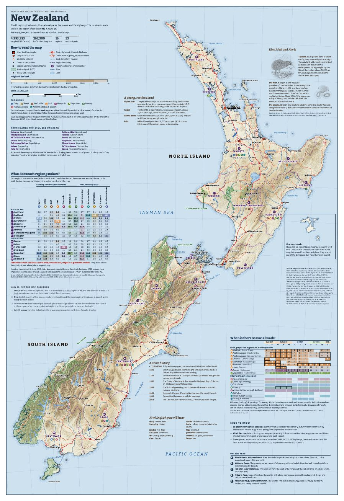
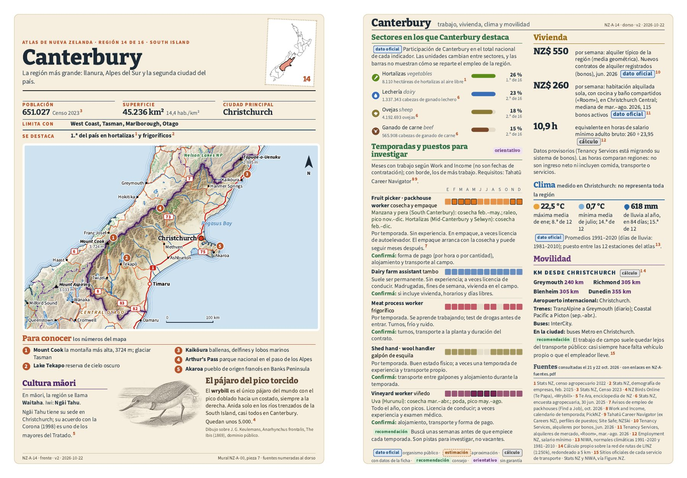
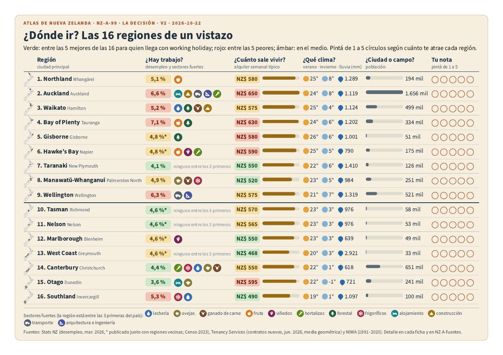

# NZ printable atlas

A printable atlas of New Zealand's 16 regions, made for people arriving on a working holiday visa. It has a wall map in nine A4 pieces, a double-sided sheet for each region, a one-page decision table and a booklet with every source. Everything is generated from open data with Python and checked automatically before it becomes a PDF.

*Leer en castellano: [README.es.md](README.es.md).*



## What's inside

| File | What it is |
|---|---|
| [`salida/nz-a/NZ-A-00-1.pdf` … `9`](salida/nz-a/) | **Wall map**, 9 A4 portrait pieces (3 × 3) with glue strips. About 57 × 83 cm assembled. In English. |
| [`salida/MAPA-MURAL-NZ-una-pagina.pdf`](salida/MAPA-MURAL-NZ-una-pagina.pdf) | The same wall map on a single 57 × 83 cm page, for a print shop. |
| [`salida/nz-a/NZ-A-01.pdf` … `16`](salida/nz-a/) | **Regional sheets**, A4 double-sided, from Northland (01) to Southland (16). Place names in English, explanations in Spanish. |
| [`salida/nz-a/NZ-A-99.pdf`](salida/nz-a/NZ-A-99.pdf) | **Where to go?** The 16 regions on one landscape page, with traffic-light colours and space for your own score. |
| [`salida/nz-a/NZ-A-fuentes.pdf`](salida/nz-a/NZ-A-fuentes.pdf) | **Sources and methods**: every numbered source from the sheets, with its link, and how each figure was calculated. |

**Wall map.**
- **Layers:** relief with elevation tints, the 16 regions, national parks, State Highways with their shields, lakes, rivers and the ferry.
- **Around the map:** a glossary of Māori names you will see on signs and curiosity blocks (the kiwi, the Alpine Fault, Taupō, slang).
- **Drawings:** Keulemans' kiwi and a kiwifruit, both in pencil.

**Regional sheet.**
- **Front:** population and area, a relief map with numbered places to visit, Māori culture, and a verified curiosity with a pencil drawing from a historical plate.
- **Back:**
  - the sectors where the region leads the country;
  - seasonal work by month, from Work and Income's calendar, with crops by zone, requirements and what to ask;
  - housing: regional rent, a room in a central suburb, and that rent in hours of minimum wage;
  - climate;
  - road distances to neighbouring cities, and transport.





## How it is made

```
open data ──► herramientas/*.py ──► datos/ (JSON) ──► generar-atlas.py ──► hojas/nz-a/*.html ──► construir.mjs ──► salida/*.pdf
```

- **Pages are HTML + SVG.**
  - Maps are drawn in NZTM2000 (EPSG:2193) with Shapely and pyproj.
  - The relief is resampled from a master raster.
  - Labels are placed by a small collision-avoiding placer.
- **`herramientas/construir.mjs` renders each page in Chromium (Playwright) and refuses to build a PDF if the layout fails print checks.** It flags:
  - reading text under 10 pt, or metadata under 8 pt;
  - text closer than 8 mm to the edge;
  - overlapping or clipped text;
  - images under 150 dpi;
  - ink coverage above the page's limit.
- **Every figure on a sheet carries its type:** official data, estimate, calculation, recommendation or indicative. Each also carries a numbered source. `NZ-A-fuentes` lists them all with links.
- **Regional sheets fit themselves.** If a front or back doesn't fit, the generator shrinks the map or drops one job from the list, and stores the result in `datos/nz/fichas-ajuste.json`.

| Script | Does |
|---|---|
| `geo-nz.py` | Base geography: regions, Natural Earth lakes and rivers, DOC national parks, relief from Terrain Tiles |
| `linz-bajar.py` + `.github/workflows/linz.yml` | Downloads LINZ Topo 1:250k layers (roads, lakes, place names) with the `LINZ_API_KEY` secret and publishes them on the orphan branch `datos-linz` |
| `linz-procesar.py` | Turns the LINZ layers into map data and checks every label against the NZ Gazetteer |
| `sectores-nz.py` | Each region's share of the national total by sector (Stats NZ via Figure.NZ) |
| `calendario-nz.py` | Seasonal work calendar from Work and Income, for every crop and region |
| `distancias-nz.py` | Road distances: shortest path on the LINZ road network |
| `imagenes.py` | Searches, downloads and prepares open-licence plates (Wikimedia Commons, Internet Archive, Openverse, the Met), recording licence and attribution |
| `generar-atlas.py` | `mural`, `fichas` or `matriz`: writes the pages into `hojas/nz-a/` (`fichas` also writes `NZ-A-fuentes`) |
| `construir.mjs` | Checks, PDF, preview and ink coverage |

## Made with Claude Code

I build with Claude Code. I have a technical background in construction and programming fundamentals, and I keep learning, but the code here is written by Claude. I decided what was needed: an atlas by regions to help choose where to go on a working holiday, a wall map plus one sheet per region, and a source for every figure. Claude wrote the scripts and the pages and tested them. I check the result through the print checks described above, which stop the build when the layout fails, not by reading the code.

## Build it yourself

You need Python 3.11+ (tested on 3.13) and Node 18+ (tested on 22).

```bash
pip install -r requirements.txt
npm install
export CHROMIUM_PATH=/path/to/chromium      # any Chromium that Playwright can drive

python3 herramientas/generar-atlas.py mural    # NZ-A-00, the 9 wall-map pieces
python3 herramientas/generar-atlas.py fichas   # NZ-A-01 to 16 and NZ-A-fuentes
python3 herramientas/generar-atlas.py matriz   # NZ-A-99
node herramientas/construir.mjs hojas/nz-a/NZ-A-14.html   # → salida/nz-a/NZ-A-14.pdf
```

The processed data is in the repository, so these commands work offline.

**Refreshing the data:**
- Re-run the data scripts. They download into `cache/`, which is not committed.
- For the LINZ layers, add a LINZ Data Service API key as the repository secret `LINZ_API_KEY` and run the "Datos de LINZ" workflow.
- `distancias-nz.py` and `linz-procesar.py` read that branch with `git fetch origin datos-linz`.

The code, comments and file names are in Spanish, the project's working language.

## Data and limits

- **Consultation date:** sources were consulted on 21 and 22 October 2026.
- **Rents:** Tenancy Services flags its bond data as provisional during a system migration.
- **Seasonal months:** these are when Work and Income reports work, not hiring dates.
- **Packhouse seasons:** no agency publishes them.
- **Climate:** each region's climate is measured at one station.

These are research leads, not job offers. Check current listings before you move.

## Licences

- **Code:** MIT, see [`LICENSE`](LICENSE). `construir.mjs` adapts `check.mjs` from [EpicInfographics](https://github.com/OrRon/EpicInfographics) (MIT, see `herramientas/LICENCIA-epicinfographics.txt`).
- **Maps, texts, pages and PDFs:** CC BY 4.0, with the exceptions in [`LICENSE-CONTENT.md`](LICENSE-CONTENT.md). Three pencil drawings stay CC BY-SA because their source scans are CC BY-SA.
- **Fonts:** Inter, Bitter, Source Sans 3 and Courier Prime under the SIL Open Font License; Special Elite under the Apache License 2.0 (`fuentes/`).

**Data credits:**
- LINZ (CC BY 4.0);
- Stats NZ (CC BY 4.0, regional boundaries via geoBoundaries);
- Natural Earth (public domain);
- DOC (CC BY 4.0);
- Terrain Tiles (Mapzen, with the LINZ elevation model, SRTM and ETOPO1);
- NIWA, Tenancy Services, Work and Income, Employment NZ and Tahatū Career Navigator.

All are listed with links in `NZ-A-fuentes`.
